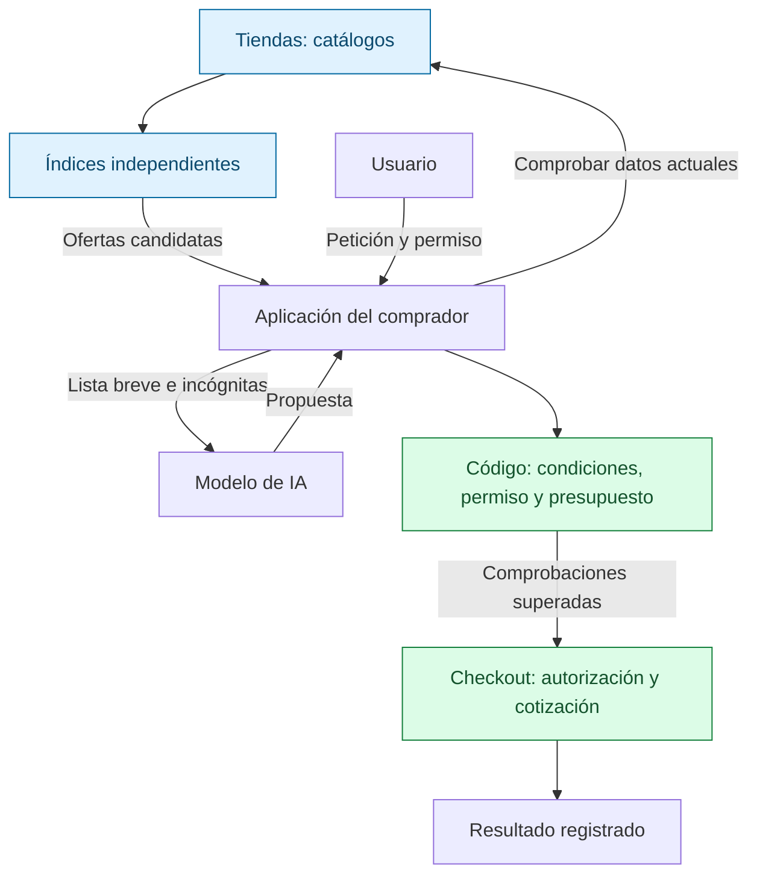

[English](README.md) | [Русский](README.ru.md) | **Español** | [简体中文](README.zh-CN.md)

# ADDP: Agent Discovery and Delegation Protocol

**Reglas comunes para encontrar ofertas de distintas tiendas, comprobar las
condiciones actuales y comprar solo dentro del permiso del usuario.**

ADDP es un protocolo abierto experimental para aplicaciones con agentes de IA.
Las tiendas publican catálogos, índices de búsqueda independientes recopilan las
ofertas y la aplicación del comprador comprueba la oferta elegida directamente con
la tienda. El modelo propone; el código de la aplicación verifica qué está permitido.

**Estado:** borrador de especificación y biblioteca de referencia en Python con
pruebas. Las compras se simulan sin dinero real. No hay una red desplegada, un
agente de compras listo para usar ni una integración con un checkout real.

Empieza por **[ADDP en cinco minutos (inglés)](docs/how-it-works.md)**: una compra,
tres diagramas y ejemplos de condiciones cambiantes y respuestas perdidas.
También está disponible [en ruso](docs/how-it-works.ru.md).
La documentación de referencia es la [inglesa](README.md).

## Para qué sirve

«Compra estos auriculares por un máximo de 350 EUR, envío incluido».

Encontrar un precio no basta: el índice puede estar desactualizado, el envío puede
superar el presupuesto y una respuesta perdida puede dejar incierto el resultado.
ADDP define la publicación de ofertas, la actualización coherente de los índices
y las comprobaciones antes de comprar. Así se pueden contrastar implementaciones
distintas con las mismas reglas.

| Participante | Beneficio previsto |
|---|---|
| Tienda | Un feed de catálogo reutilizable por índices compatibles |
| Operador de índice | Reglas explícitas para cambios, eliminaciones y consultas |
| Desarrollador de agentes | Interfaz común de búsqueda y reglas de aprobación y recuperación |
| Comprador | Separación clara entre una sugerencia y una compra autorizada |

Son objetivos de diseño; la adopción, el beneficio comercial y el rendimiento
a gran escala aún no están demostrados.

## Una compra

1. **Encontrar.** El índice muestra 329 EUR; el total con envío aún se desconoce.
2. **Comprobar.** La aplicación consulta los datos actuales de la tienda. Si ahora
   son 389 EUR, descarta la oferta sin aumentar el límite.
3. **Autorizar.** El usuario aprueba el artículo y el límite mediante el mecanismo
   de confirmación de la aplicación. Una propuesta del modelo no crea permiso.
4. **Verificar el total.** El checkout ofrece una cotización con las condiciones y
   el total exacto que debe hacer cumplir: 333,99 EUR caben; 351 EUR no.
5. **Ejecutar y recuperar.** La aplicación reserva el importe en su registro local
   del presupuesto. Si pierde la respuesta, consulta el resultado; un reenvío
   permitido conserva el identificador de operación.

La búsqueda funciona por separado. El perfil de ejecución de compras es opcional.

## Quién hace qué



El índice ayuda a encontrar; la tienda aporta los datos actuales. El usuario da
permiso y la aplicación y el checkout aplican sus comprobaciones. Ni el índice
ni el modelo pueden ampliar ese permiso.

## Qué está implementado

- Instantáneas de catálogos y cambios numerados, con eliminaciones; filtros tipados
  y paginación reproducible en orden fijo.
- Comprobación de ofertas actuales frente a condiciones de búsqueda y restricciones privadas.
- Registro persistente del presupuesto y checkout simulado, con protección contra
  operaciones duplicadas y recuperación tras perder una respuesta.
- Adaptador de solo lectura del catálogo REST de UCP `2026-08-25`: búsqueda y lookup,
  sin checkout. La [prueba completa](tests/test_purchase_flow.py) conecta búsqueda,
  elección simulada del modelo, aprobación y ejecución.

Una aplicación debe conectar las piezas de la biblioteca. No hay cliente HTTP
de producción ni cliente OAuth.

## Límites y preguntas abiertas

- La primera página no contiene necesariamente las ofertas más baratas. El orden
  depende de identificadores; buscar el mínimo dentro de un ámbito declarado exige
  revisar todas las páginas coincidentes. Eso tampoco equivale a buscar en toda la web.
- Consultar a la tienda detecta discrepancias con el índice, pero no demuestra su
  honestidad ni la entrega futura. El orden fijo no elimina la inclusión pagada
  ni la manipulación de identificadores.
- Evitar una operación duplicada depende de que el checkout registre y respete
  sus resultados. Compartir un límite entre dispositivos exige una autoridad común.
- UCP y ACP ya cubren partes del catálogo y del checkout. ADDP explora feeds
  coherentes entre tiendas, consultas comparables y reglas de ejecución. La necesidad
  de un protocolo separado sigue abierta. Véanse la [comparación por versiones](docs/prior-art.md)
  y los [próximos experimentos](docs/design-rationale.md#what-to-validate-next).

La especificación es un [Internet-Draft -00](rfc/draft-kibin-addp-00.xml), aún no
presentado al IETF. Cubre búsquedas y la compra simulada de una unidad; las reservas
y otras acciones necesitan perfiles adicionales.

## Más información

- [Decisiones y compromisos de diseño](docs/design-rationale.md) (inglés).
- [Integración de modelos, incluidos Jev y Laya](docs/model-integration.md): propuesta
  sin implementación ni respaldo de esos proyectos.
- [Mediciones de entrada](docs/measurements.md): al filtrar 16 ofertas hasta quedarse
  con 3, una entrada sintética bajó de 2226 a 315 tokens. No se midió la calidad de
  las decisiones ni se demostró una mejora del éxito de las compras.

## Repositorio

| Ruta | Contenido |
|---|---|
| [`rfc/`](rfc/) | La especificación (RFCXML v3), ejemplos generados, bibliografía |
| [`schemas/0.1/`](schemas/0.1/) | JSON Schema para cada mensaje (solo forma) |
| [`examples/`](examples/) | Mensajes válidos e inválidos, datos de prueba de UCP |
| [`reference/addp/`](reference/addp/) | Implementación de referencia en Python |
| [`tests/`](tests/) | Pruebas de la implementación, una compra de extremo a extremo y comprobaciones del borrador frente al código |
| [`tools/`](tools/) | Generadores, compilación del borrador, script de mediciones |
| [`docs/`](docs/) | Trabajos previos, justificación del diseño, integración de modelos, mediciones, lista para publicar |

## Ejecución

```sh
python -m venv .venv
.venv/bin/python -m pip install -r requirements-dev.txt   # .venv/Scripts on Windows

.venv/bin/python -m pytest                  # all tests, no network
.venv/bin/python tools/build_draft.py       # draft -> build/draft-kibin-addp-00.{txt,html,xml}
.venv/bin/python tools/measure_context.py --download   # token measurement
```

Python 3.14. Las pruebas y la compilación del borrador funcionan sin red. La
implementación de referencia no tiene un cliente HTTP real ni realiza pagos: las pruebas
la manejan mediante un transporte controlado y un servicio de ejecución de pruebas.

## Contribuir

Lo más útil ahora: problemas de diseño, trabajos previos que se nos escaparon, segundas
implementaciones y mediciones a nivel de tarea. Véase [CONTRIBUTING.md](CONTRIBUTING.md).

## Licencia

Apache License 2.0; véanse [LICENSE](LICENSE) y [NOTICE](NOTICE). La especificación está
pensada para enviarse al IETF, bajo las reglas del IETF sobre contribuciones.

Autor: Aleksandr Kibin ([@famfamfam](https://github.com/famfamfam)).
