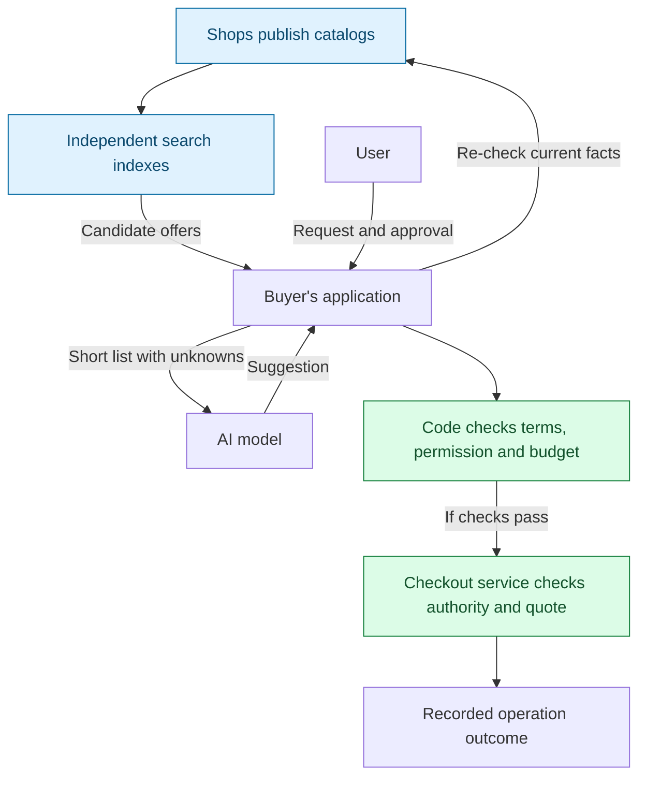

**English** | [Русский](README.ru.md) | [Español](README.es.md) | [简体中文](README.zh-CN.md)

# ADDP: Agent Discovery and Delegation Protocol

**Shared rules for finding offers across shops, checking current terms, and buying
only within the user's permission.**

ADDP is an experimental open protocol for applications with AI agents. A shop
publishes its catalog, independent search indexes collect offers, and the buyer's
application checks the chosen offer directly with the shop before proceeding.
The AI model can suggest a choice; application code checks what is allowed.

**Status:** a draft specification and a Python reference library with tests.
Purchases run in a sandbox and move no money. There is no deployed search network,
ready-to-use shopping agent or real checkout integration in this repository.

Start with **[ADDP in five minutes](docs/how-it-works.md)**: one purchase, three
diagrams, and an explanation of what happens when conditions change or a response
is lost. Also available [in Russian](docs/how-it-works.ru.md).

## Why this is useful

Consider: “Buy these headphones, at most EUR 350 including delivery.”

Finding a page with a price is only the beginning. Search data can be stale,
shipping can put the total over budget, and a lost checkout response can leave the
application unsure whether an order exists.

ADDP defines how shops publish offers, how indexes keep their copies consistent,
and what an application must check before a purchase. A shared contract lets
different implementations be tested against the same rules.

| Participant | Intended benefit |
|---|---|
| Shop | One catalog feed readable by any compatible index |
| Index operator | Explicit rules for updates, deletions and query results |
| Agent developer | A common discovery interface and rules for approval and recovery |
| Buyer | Clear separation between a suggested offer and an authorized purchase |

These are design goals. Adoption, commercial benefit and performance at scale
have not been established.

## One purchase

1. **Find.** An index reports headphones at EUR 329. This is an offer to investigate;
   the delivered total is still unknown.
2. **Check.** The application asks the shop for current facts. If the item now costs
   EUR 389, it rejects this candidate without raising the user's limit.
3. **Authorize.** The user approves the specific item and spending limit through the
   application's trusted approval path. A model's suggestion cannot create approval.
4. **Check the total.** The checkout service provides a quote: the terms and exact
   total it will enforce. EUR 333.99 fits; EUR 351 does not.
5. **Execute and recover.** The application reserves the amount in its local budget
   record and sends the operation. If the response is lost, it checks the outcome;
   a permitted resend uses the same operation identifier.

Search can be used on its own. The purchase runtime profile is optional.

## Who does what



Indexes help find candidates. The shop supplies current facts. The user grants
permission, and both the application and the checkout service enforce their checks.
An index or model cannot expand that permission.

## What is implemented

- Catalog snapshots and numbered changes, including deletions; typed filters and
  repeatable pagination in a fixed order.
- Checks of current offer facts against search conditions and private constraints.
- A durable local budget journal and sandbox checkout with duplicate-operation
  protection and recovery after lost responses.
- A read-only adapter for the UCP `2026-08-25` REST catalog: search and lookup,
  without checkout. The [end-to-end test](tests/test_purchase_flow.py) connects
  discovery, simulated model choice, approval and sandbox execution.

The reference implementation is a library. A host application must connect these
pieces; there is no production HTTP client or OAuth client.

## Limits and open questions

- An index's first page is not a list of the cheapest offers. Results use a fixed
  identifier order; finding the cheapest within a stated search scope requires
  examining all matching pages. Even that does not mean searching the whole web.
- Checking with a shop catches disagreements with the index; it does not prove the
  shop is honest or that it will deliver. Fixed ordering does not prevent paid
  inclusion or manipulation of identifiers.
- Duplicate-operation protection depends on the checkout service recording and
  enforcing outcomes. A local budget journal cannot enforce one shared limit across
  devices without a common authority.
- UCP and ACP already cover parts of catalog and checkout behavior. ADDP explores
  consistent feeds across shops, comparable index queries and runtime rules. Whether
  these need a separate protocol remains open. See the version-scoped
  [prior-art review](docs/prior-art.md) and [next experiments](docs/design-rationale.md#what-to-validate-next).

The specification is an [Internet-Draft -00](rfc/draft-kibin-addp-00.xml), not yet
submitted to the IETF. It covers offer search and a sandbox purchase of one item.
Bookings and other actions need additional profiles.

## Read more

- [Design rationale and tradeoffs](docs/design-rationale.md).
- [Model integration, including Jev and Laya](docs/model-integration.md): design
  notes; neither integration is implemented or endorsed by those projects.
- [Input-size measurements](docs/measurements.md): synthetic input shrank from
  2,226 to 315 tokens after filtering 16 offers down to 3. Decision quality has
  not been measured; this is not a demonstrated improvement in shopping success.

## Repository

| Path | Contents |
|---|---|
| [`rfc/`](rfc/) | The specification (RFCXML v3), generated examples, bibliography |
| [`schemas/0.1/`](schemas/0.1/) | JSON Schemas for every message (form only) |
| [`examples/`](examples/) | Valid and invalid messages, UCP fixtures |
| [`reference/addp/`](reference/addp/) | Reference implementation in Python |
| [`tests/`](tests/) | Tests of the implementation, an end-to-end purchase, and checks of the draft against the code |
| [`tools/`](tools/) | Generators, draft build, measurement script |
| [`docs/`](docs/) | Prior art, design rationale, model integration, measurements, publishing checklist |

## Running it

```sh
python -m venv .venv
.venv/bin/python -m pip install -r requirements-dev.txt   # .venv/Scripts on Windows

.venv/bin/python -m pytest                  # all tests, no network
.venv/bin/python tools/build_draft.py       # draft -> build/draft-kibin-addp-00.{txt,html,xml}
.venv/bin/python tools/measure_context.py --download   # token measurement
```

Python 3.14. The tests and the draft build run without network access. The reference
implementation has no real HTTP client and makes no payments: tests drive it through a
controlled transport and a sandbox execution service.

## Contributing

Design problems, prior art we missed, second implementations and task-level
measurements are the most useful contributions. See
[CONTRIBUTING.md](CONTRIBUTING.md).

## License

Apache License 2.0; see [LICENSE](LICENSE) and [NOTICE](NOTICE). The specification is
intended for submission to the IETF, under the IETF's rules for contributions.

Author: Aleksandr Kibin ([@famfamfam](https://github.com/famfamfam)).
