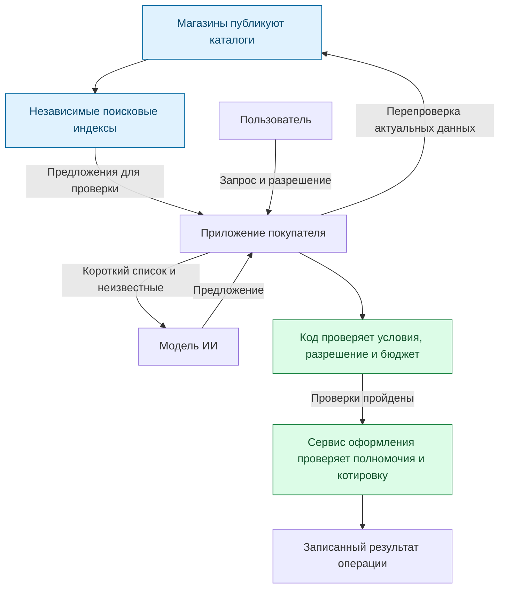

[English](README.md) | **Русский** | [Español](README.es.md) | [简体中文](README.zh-CN.md)

# ADDP: Agent Discovery and Delegation Protocol

**Общие правила, по которым приложения с ИИ находят предложения разных магазинов,
проверяют актуальные условия и покупают только в пределах разрешения человека.**

ADDP — экспериментальный открытый протокол. Магазин публикует каталог, независимые
поисковые индексы собирают предложения, а приложение покупателя проверяет выбранное
предложение непосредственно у магазина. Модель ИИ может предложить выбор;
программный код проверяет, что разрешено сделать.

**Сейчас здесь:** черновик спецификации и эталонная библиотека на Python с тестами.
Покупки проходят в песочнице без настоящих денег. Работающей поисковой сети,
готового агента для покупок и интеграции с реальным оформлением заказов пока нет.

Начните с **[«ADDP за пять минут»](docs/how-it-works.ru.md)**: одна покупка, три
схемы и объяснение того, что происходит при изменении условий и потере ответа.
Основная версия документации — [английская](README.md).

## Зачем это нужно

Представьте просьбу: «Купи эти наушники, не дороже 350 евро вместе с доставкой».

Найти страницу с ценой — только начало. Данные поиска могут устареть, доставка —
вывести итог за пределы бюджета, а потерянный ответ при оформлении — оставить
приложение в неведении, существует ли заказ.

ADDP задаёт правила публикации предложений, согласованного обновления их копий в
индексах и проверок перед покупкой. Общий контракт позволяет проверять разные
реализации по одним правилам.

| Участник | Предполагаемая польза |
|---|---|
| Магазин | Один поток данных каталога для любых совместимых индексов |
| Оператор индекса | Явные правила обновлений, удалений и результатов поиска |
| Разработчик агента | Общий интерфейс поиска и правила разрешения покупок и восстановления |
| Покупатель | Понятное разделение между предложенным товаром и разрешённой покупкой |

Это цели проекта. Массовое внедрение, коммерческая польза и производительность
на больших объёмах ещё не подтверждены.

## Одна покупка

1. **Найти.** Индекс сообщает о наушниках за 329 евро. Это кандидат для проверки;
   итог с доставкой пока неизвестен.
2. **Проверить.** Приложение запрашивает актуальные данные у магазина. Если товар
   теперь стоит 389 евро, предложение отбрасывается, а лимит пользователя сохраняется.
3. **Получить разрешение.** Пользователь одобряет конкретный товар и лимит через
   предусмотренный приложением путь подтверждения. Предложение модели не создаёт разрешение.
4. **Проверить итог.** Сервис оформления выдаёт котировку — условия и точную итоговую
   сумму, соответствие которым он обязан проверить. 333,99 евро подходят; 351 евро — нет.
5. **Выполнить и проверить результат.** Приложение резервирует сумму в своём учёте
   бюджета и отправляет операцию. При потере ответа оно выясняет результат;
   допустимый повтор использует тот же идентификатор операции.

Поиск можно использовать отдельно. Профиль исполнения покупок необязателен.

## Кто за что отвечает



Индекс помогает найти кандидатов. Магазин сообщает актуальные данные. Пользователь
даёт разрешение, а приложение и сервис оформления выполняют свои проверки.
Индекс и модель не могут расширить это разрешение.

## Что уже реализовано

- Снимки каталогов и пронумерованные изменения, включая удаления; типизированные
  фильтры и воспроизводимая выдача по страницам в фиксированном порядке.
- Проверка актуального предложения по условиям поиска и личным ограничениям.
- Сохраняемый на диске журнал бюджета и оформление в песочнице с защитой от
  повторного исполнения операции и восстановлением после потери ответа.
- Адаптер только для чтения REST-каталога UCP `2026-08-25`: поиск и получение
  товара по идентификатору, без оформления. [Сквозной тест](tests/test_purchase_flow.py)
  связывает поиск, имитацию выбора модели, одобрение и исполнение в песочнице.

Эталонная реализация — библиотека. Связать её части должно внешнее приложение;
готового HTTP-клиента для реальных запросов и OAuth-клиента здесь нет.

## Ограничения и открытые вопросы

- Первая страница индекса не обязательно содержит самые дешёвые предложения:
  порядок определяется идентификаторами. Для поиска минимума в обозначенной области
  нужно просмотреть все подходящие страницы. Это всё равно не поиск по всему интернету.
- Проверка у магазина выявляет расхождения с индексом, но не доказывает честность
  продавца или будущую доставку. Фиксированный порядок не устраняет платное включение
  в индекс и манипуляции идентификаторами.
- Защита от повторного исполнения зависит от сервиса оформления, который должен
  записывать и соблюдать результаты операций. Общий лимит на нескольких устройствах
  требует общего сервиса контроля; одного локального журнала недостаточно.
- UCP и ACP уже описывают часть работы с каталогами и оформлением. ADDP исследует
  согласованные потоки данных разных магазинов, сопоставимые запросы к индексам и
  правила исполнения. Нужен ли для этого отдельный протокол — открытый вопрос.
  См. [сравнение конкретных версий](docs/prior-art.md) и
  [следующие эксперименты](docs/design-rationale.md#what-to-validate-next) на английском.

Спецификация — [Internet-Draft -00](rfc/draft-kibin-addp-00.xml), ещё не поданный
в IETF. Она охватывает поиск предложений и покупку одной единицы товара в песочнице.
Для бронирований и других действий потребуются дополнительные профили.

## Подробнее

- [Почему проект устроен так и какие есть компромиссы](docs/design-rationale.md).
- [Подключение моделей, включая Jev и Laya](docs/model-integration.md): проектные
  заметки; интеграции не реализованы и не одобрены этими проектами.
- [Измерение размера входа модели](docs/measurements.md): в синтетическом примере
  после отбора 3 предложений из 16 размер сократился с 2 226 до 315 токенов.
  Качество выбора не измерялось; улучшение успешности покупок этим не доказано.

## Репозиторий

| Путь | Содержимое |
|---|---|
| [`rfc/`](rfc/) | Спецификация (RFCXML v3), сгенерированные примеры, библиография |
| [`schemas/0.1/`](schemas/0.1/) | JSON Schema для каждого сообщения (только форма) |
| [`examples/`](examples/) | Корректные и некорректные сообщения, фикстуры UCP |
| [`reference/addp/`](reference/addp/) | Эталонная реализация на Python |
| [`tests/`](tests/) | Тесты реализации, сквозная покупка и сверка черновика с кодом |
| [`tools/`](tools/) | Генераторы, сборка черновика, скрипт замеров |
| [`docs/`](docs/) | Аналоги, обоснование решений, подключение моделей, замеры, план публикации |

## Запуск

```sh
python -m venv .venv
.venv/bin/python -m pip install -r requirements-dev.txt   # .venv/Scripts on Windows

.venv/bin/python -m pytest                  # all tests, no network
.venv/bin/python tools/build_draft.py       # draft -> build/draft-kibin-addp-00.{txt,html,xml}
.venv/bin/python tools/measure_context.py --download   # token measurement
```

Python 3.14. Тесты и сборка черновика работают без сети. У эталонной реализации нет
настоящего HTTP-клиента, и она не проводит платежей: тесты управляют ею через
контролируемый транспорт и сервис-песочницу.

## Участие

Полезнее всего сейчас: проблемы в дизайне, пропущенные аналоги, вторые реализации и замеры
на уровне задач. См. [CONTRIBUTING.md](CONTRIBUTING.md).

## Лицензия

Apache License 2.0; см. [LICENSE](LICENSE) и [NOTICE](NOTICE). Спецификация предназначена
для подачи в IETF по правилам IETF для вкладов.

Автор: Aleksandr Kibin ([@famfamfam](https://github.com/famfamfam)).
