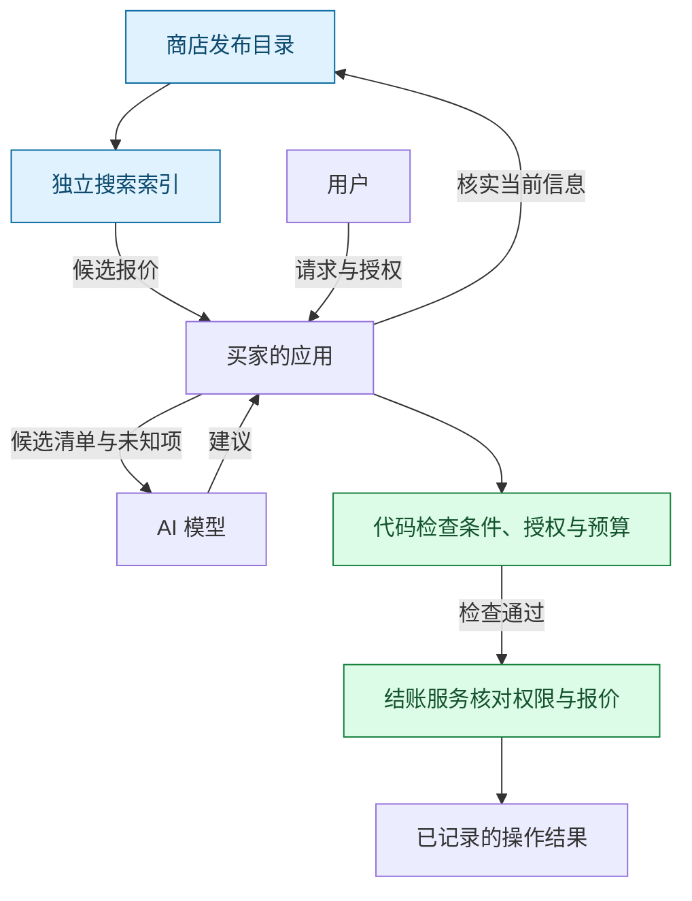

[English](README.md) | [Русский](README.ru.md) | [Español](README.es.md) | **简体中文**

# ADDP: Agent Discovery and Delegation Protocol

**让 AI 应用按统一规则查找不同商店的报价、核实当前条件，并在用户授权范围内购买。**

ADDP 是一个实验性的开放协议。商店发布商品目录，独立搜索索引汇集报价，买家的应用再直接向商店核实选中的商品。AI 模型可以提出建议；应用代码负责检查哪些操作获得了许可。

**目前的成果：**规范草案、Python 参考库和测试。购买只在沙盒中模拟，不涉及真实资金。仓库中还没有已部署的搜索网络、可直接使用的购物智能体或真实结账集成。

从 **[五分钟了解 ADDP（英文）](docs/how-it-works.md)** 开始：一次购买、三张图，以及条件变化或响应丢失时的处理方式。另有[俄文版](docs/how-it-works.ru.md)。文档以[英文版](README.md)为准。

## 为什么需要它

假设用户说：“买这款耳机，含运费不超过 350 欧元。”

找到价格只是第一步。索引可能过时，运费可能使总额超出预算，结账响应丢失后，应用可能无法确定订单是否已经生成。

ADDP 定义商店如何发布报价、索引如何一致地更新副本，以及购买前应用必须做哪些检查。共同的规则让不同实现能够接受相同的验证。

| 参与者 | 预期收益 |
|---|---|
| 商店 | 一份目录数据流可供任何兼容索引读取 |
| 索引运营者 | 明确的更新、删除和查询规则 |
| 智能体开发者 | 统一的发现接口，以及授权和恢复规则 |
| 买家 | 清楚区分推荐商品与已获授权的购买 |

这些是设计目标。实际采用情况、商业收益和大规模性能尚未得到验证。

## 一次购买

1. **查找。**索引给出的耳机价格是 329 欧元；含运费总额仍未知。
2. **核实。**应用向商店查询当前信息。如果价格已变为 389 欧元，就排除该报价，不提高用户的限额。
3. **授权。**用户通过应用的确认流程批准具体商品和支出限额。模型的建议不能生成授权。
4. **检查总额。**结账服务给出并负责核对报价中的条件和准确总额：333.99 欧元符合限额，351 欧元则不符合。
5. **执行与恢复。**应用在本地预算记录中预留金额，然后发送操作。响应丢失时查询结果；允许重发时沿用同一个操作标识符。

搜索可以单独使用。购买执行规范是可选的。

## 各方的职责



索引用于发现候选报价，商店提供当前信息。用户授予权限，应用和结账服务分别执行检查。索引和模型都不能扩大权限。

## 已实现的部分

- 目录快照、带序号的变更和显式删除；类型化筛选和固定顺序下可重复的分页结果。
- 根据搜索条件和私有限制核实商店当前的报价信息。
- 持久化的本地预算日志，以及支持防止重复操作和响应丢失恢复的沙盒结账。
- UCP `2026-08-25` REST 目录只读适配器：搜索和按标识符查询，不包含结账。[端到端测试](tests/test_purchase_flow.py)串联搜索、模拟的模型选择、批准和沙盒执行。

宿主应用需要自行连接参考库的各个部分。目前没有生产环境 HTTP 客户端或 OAuth 客户端。

## 局限与待解问题

- 索引第一页不一定包含最便宜的报价。结果按标识符排序；要在明确的搜索范围内找到最低价，必须检查所有匹配页面。这仍不代表搜索了整个互联网。
- 向商店核实能发现其信息与索引的差异，但不能证明卖家诚实或保证发货。固定排序也不能消除付费收录或标识符操纵。
- 防止重复操作依赖结账服务记录并遵守操作结果。多个设备共用一个限额需要共同的控制服务，单个本地日志无法做到这一点。
- UCP 和 ACP 已覆盖部分目录与结账行为。ADDP 探索跨商店的一致数据流、可比较的索引查询和运行时规则。是否需要独立协议仍未确定。参见[按版本比较的相关工作](docs/prior-art.md)和[下一步实验](docs/design-rationale.md#what-to-validate-next)（英文）。

规范为 [Internet-Draft -00](rfc/draft-kibin-addp-00.xml)，尚未提交给 IETF。当前范围是报价搜索和单件商品的沙盒购买；预订等其他操作需要额外的规范。

## 延伸阅读

- [设计理由与取舍](docs/design-rationale.md)（英文）。
- [模型集成，包括 Jev 和 Laya](docs/model-integration.md)：设计说明，尚未实现，也未获这些项目认可。
- [模型输入大小测量](docs/measurements.md)：将 16 个报价筛选为 3 个后，合成输入从 2,226 tokens 降至 315。尚未测量决策质量，也未证明购物成功率提高。

## 仓库结构

| 路径 | 内容 |
|---|---|
| [`rfc/`](rfc/) | 规范（RFCXML v3）、生成的示例、参考文献 |
| [`schemas/0.1/`](schemas/0.1/) | 每种消息的 JSON Schema（仅校验结构） |
| [`examples/`](examples/) | 合法与非法消息、UCP 测试数据 |
| [`reference/addp/`](reference/addp/) | Python 参考实现 |
| [`tests/`](tests/) | 实现测试、端到端购买测试，以及草案与代码的一致性测试 |
| [`tools/`](tools/) | 生成器、草案构建、测量脚本 |
| [`docs/`](docs/) | 相关工作、设计理由、模型接入、测量结果、发布清单 |

## 运行

```sh
python -m venv .venv
.venv/bin/python -m pip install -r requirements-dev.txt   # .venv/Scripts on Windows

.venv/bin/python -m pytest                  # all tests, no network
.venv/bin/python tools/build_draft.py       # draft -> build/draft-kibin-addp-00.{txt,html,xml}
.venv/bin/python tools/measure_context.py --download   # token measurement
```

需要 Python 3.14。测试和草案构建都无需联网。参考实现没有真正的 HTTP 客户端，也不进行任何支付：测试通过受控的传输层和沙盒执行服务来驱动它。

## 参与贡献

目前最有用的贡献是：设计上的问题、我们遗漏的相关工作、第二个独立实现，以及任务级别的测量。见 [CONTRIBUTING.md](CONTRIBUTING.md)。

## 许可证

Apache License 2.0；见 [LICENSE](LICENSE) 和 [NOTICE](NOTICE)。本规范计划按 IETF 的贡献规则提交给 IETF。

作者：Aleksandr Kibin（[@famfamfam](https://github.com/famfamfam)）。
