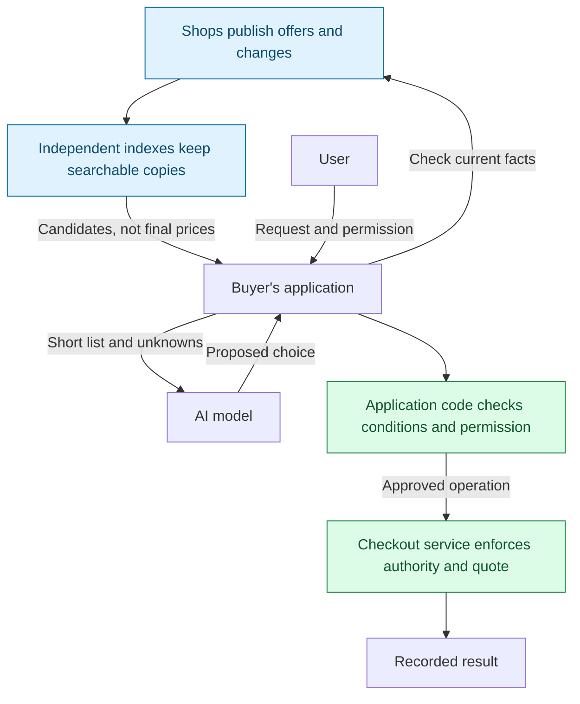
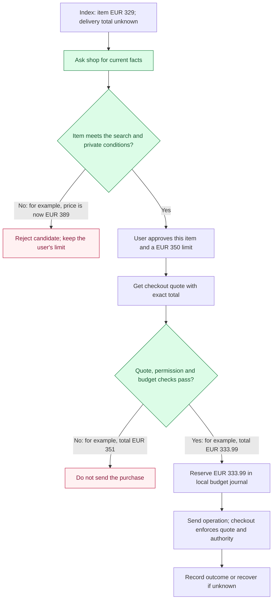
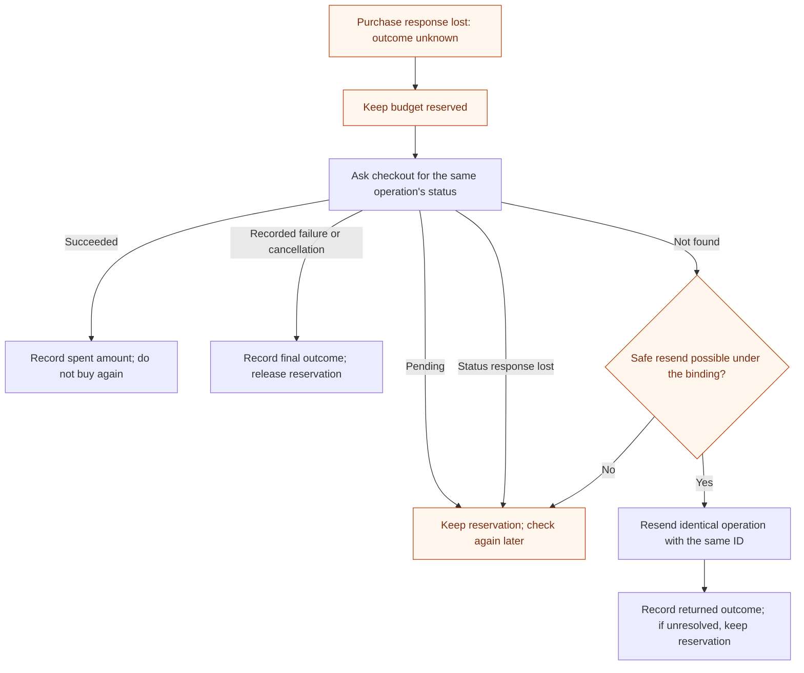

**English** | [Русский](how-it-works.ru.md)

# ADDP in five minutes

You ask an assistant: **“Buy these headphones, at most EUR 350 including delivery.”**
To do that reliably, its application needs more than a model that can read a shop
page. It needs ways to find offers, check current conditions, record your permission
and find out whether a purchase happened after a connection failed.

ADDP proposes shared rules for those steps. It is currently a specification draft
and a tested reference library. The purchase described here is a sandbox example;
no real order or payment is made.

## 1. Who takes part?

Think of an index as a searchable copy of shop catalogs. It helps the application
avoid asking every shop separately for every search. The copy can be incomplete or
out of date, so the application returns to the shop before relying on an offer.

| Role | Its job | Limit of that role |
|---|---|---|
| Shop, called a *publisher* | Publish offers and current facts | Its statements do not prove honesty or delivery |
| Index | Collect and filter offers | Its copy is not a binding checkout quote |
| Buyer's application, including the *runtime* | Check conditions, record approval, track the budget and operation | A local journal alone cannot enforce a shared limit across devices |
| AI model | Interpret preferences and propose a choice | It cannot approve spending or change the recorded permission |
| Checkout service | Enforce authorization and the quote, record the operation's outcome | It must actually implement the guarantees required by the binding |

The runtime is ordinary application code around the model. A *binding* is an
installed adapter for a particular checkout protocol. ADDP currently has only a
sandbox execution binding. Shops and indexes cannot install such code in the
buyer's application.

## 2. Follow the EUR 350 purchase

The index finds headphones at **EUR 329**. The application may let the model
propose this candidate from a short list. At this point it is still an index claim:
the app cannot say the offer satisfies every condition, especially the total budget.

The permission record is called an *intent*. In this example it names the item and
quantity, allows purchase, sets a spending limit and an expiry, and identifies the
approved operation definition. A trusted approval path creates it; the model
cannot change it. “Find headphones” by itself grants no permission to buy them.

The checkout *quote* fixes the exact total the service must enforce. An item price
is not a delivered total: shipping and tax may still be unknown. A change within
the approved constraints can be acceptable; a changed quote at execution must be
rejected if it no longer matches the operation the application checked.

“Reserve” here means marking an amount as unavailable in the application's budget
journal. It is not a hold on a bank account. Reserving and checking the remaining
budget together prevents concurrent local operations from spending the same allowance.

The illustration follows the reference test's order: check the item, obtain approval,
then check the quote. A host can obtain the quote earlier or use an applicable prior
approval. In every case, the required checks and approval precede execution.

## 3. What if the reply is lost?

A shop may have accepted the purchase just before the connection broke.
**No response does not mean no order.** The application keeps the budget reserved
until it obtains a conclusive outcome.

“Not found” is not enough to declare failure: the original request could still be
in transit. A resend is allowed only while the binding's authorization and
operation-retention rules make it safe. The service must record one outcome for
an identifier, reject conflicting reuse and return the recorded outcome for an
identical repeat. A new identifier would describe a different operation.

This depends on the checkout service as well as the application. The sandbox keeps
the quote, authorization and outcome in one database; a real integration must
establish the guarantees across its own services. If the service stays unavailable,
the operation can stay unresolved. ADDP does not promise eventual completion.

## What does a shop need to publish?

A small discovery document at `/.well-known/addp` tells compatible applications
where to find the shop's resources. An optional *feed* supplies a complete snapshot
and numbered changes. Explicit deletion events tell indexes when an offer disappears.
Missing changes require recovery rather than silently skipping updates.

The repository also has a read-only UCP catalog adapter. It demonstrates reading
supported UCP catalogs without a new ADDP feed, but does not provide UCP checkout
or the consistency guarantees of a native change feed.

Publishing a document does not automatically connect a shop to every assistant.
Someone must operate an index that ingests it, and an application must support the
protocol. A buyer can use discovery without enabling purchases.

## What the idea does and does not establish

The useful experiment is a shared, testable contract across shop feeds, indexes
and applications. Existing catalog and checkout protocols already cover parts of
this path; see the [version-scoped comparison](prior-art.md).

There are important tradeoffs:

- **Comparable results cost something.** Indexes return matches in identifier order,
  not cheapest first. Finding a minimum within the chosen search scope requires
  reading all matching pages. If collection stops early, the app can describe only
  the offers examined. Even a complete index can omit shops from the wider market.
- **Current does not mean true.** Re-checking can catch stale index data, but a
  dishonest publisher can also lie in its current response. Fixed ordering does not
  eliminate manipulation of identifiers or paid inclusion.
- **Permission limits actions, not influence.** A malicious product description can
  still influence the model's choice among permitted offers. Keeping permission out
  of the model's control limits what such a suggestion can cause.
- **A smaller input is not a better decision by itself.** Synthetic token counts
  demonstrate less input after filtering; decision quality remains unmeasured.

The next evidence needed is a second independent implementation, measurements of
search across many pages, and a real checkout binding that meets the recovery
requirements. Those experiments should help decide whether ADDP belongs in a
standalone standard or in profiles of existing protocols.

## Where to go next

- [README](../README.md): current status and run commands.
- [End-to-end purchase test](../tests/test_purchase_flow.py): the simulated purchase
  behind the example, including price changes and a lost response.
- [Design decisions and next experiments](design-rationale.md#what-to-validate-next).
- [Specification](../rfc/draft-kibin-addp-00.xml): normative requirements. This
  overview is explanatory; the diagrams omit lower-level validation and error cases.
