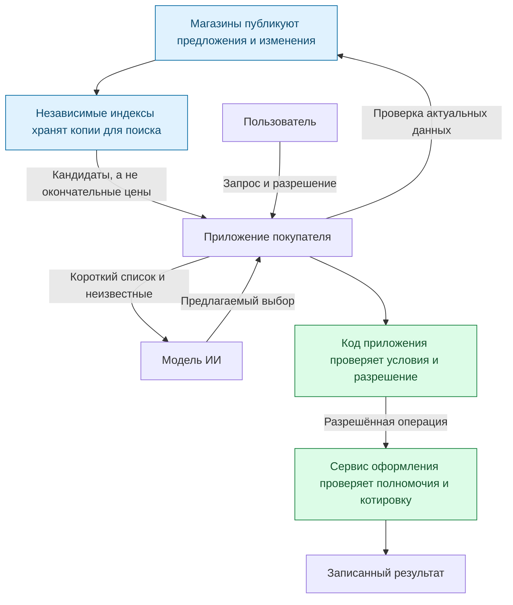
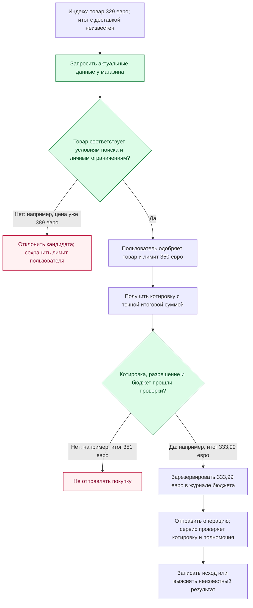
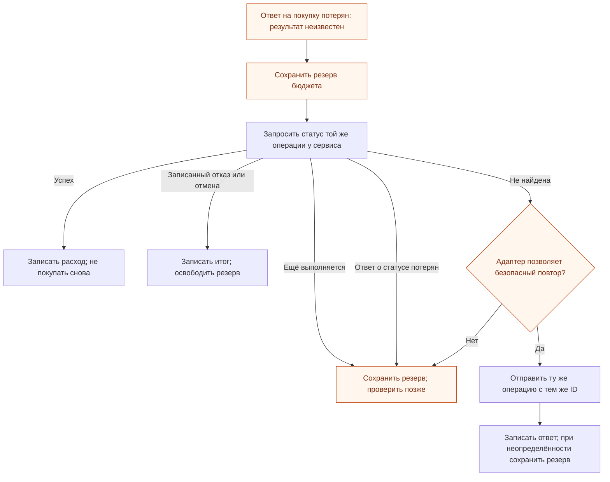

[English](how-it-works.md) | **Русский**

# ADDP за пять минут

Вы просите помощника: **«Купи эти наушники, не дороже 350 евро вместе с доставкой».**
Для надёжного выполнения его приложению мало модели, умеющей читать сайт магазина.
Нужно найти предложения, проверить актуальные условия, записать ваше разрешение
и выяснить, состоялась ли покупка, если соединение оборвалось.

ADDP предлагает общие правила для этих шагов. Сейчас это черновик спецификации
и эталонная библиотека с тестами. Описанная ниже покупка — пример из песочницы;
настоящий заказ и платёж не создаются.

## 1. Кто участвует?

Индекс — это доступная для поиска копия каталогов магазинов. Благодаря ей
приложению не нужно опрашивать каждый магазин отдельно при каждом поиске.
Копия может быть неполной или устаревшей, поэтому перед использованием предложения
приложение возвращается к самому магазину.

| Роль | За что отвечает | Где заканчиваются её возможности |
|---|---|---|
| Магазин, или *издатель* | Публикует предложения и актуальные данные | Его утверждения не доказывают честность и будущую доставку |
| Индекс | Собирает и фильтрует предложения | Его копия не является обязательной для оформления котировкой |
| Приложение покупателя, включая *среду исполнения* | Проверяет условия, записывает разрешение, учитывает бюджет и состояние операции | Локального журнала недостаточно для общего лимита на нескольких устройствах |
| Модель ИИ | Интерпретирует предпочтения и предлагает выбор | Не может разрешить расход или изменить записанное разрешение |
| Сервис оформления | Проверяет полномочия и котировку, записывает исход операции | Должен действительно выполнять требования адаптера исполнения |

Среда исполнения — обычный программный код вокруг модели. *Адаптер исполнения*
(*binding*) — установленный модуль для конкретного протокола оформления заказа.
Сейчас у ADDP есть только адаптер песочницы. Магазины и индексы не могут
устанавливать такой код в приложение покупателя.

## 2. Покупка в пределах 350 евро

Индекс находит наушники за **329 евро**. Приложение может дать модели короткий
список и попросить предложить кандидата. Пока это лишь данные индекса: приложение
ещё не может утверждать, что предложение соответствует всем условиям, особенно
лимиту итоговой суммы.

Запись разрешения называется *intent*. В этом примере она указывает товар
и количество, разрешает покупку, задаёт лимит и срок действия, а также фиксирует
одобренное описание операции. Её создаёт предусмотренный приложением путь
подтверждения; модель не может её менять. Просьба «найди наушники» сама по себе
не разрешает их покупать.

*Котировка* (*quote*) сервиса оформления фиксирует точную итоговую сумму, которую
он обязан проверить при исполнении. Цена товара не равна итогу с доставкой:
стоимость доставки и налоги могут быть ещё неизвестны. Изменение в пределах
одобренных ограничений может быть допустимо; если при исполнении котировка
изменилась и больше не соответствует проверенной операции, сервис должен её отклонить.

«Резервировать» здесь означает пометить сумму как занятую в журнале бюджета
приложения. Это не блокировка денег на банковском счёте. Проверка остатка
и резервирование в одной транзакции не дают параллельным локальным операциям
израсходовать один и тот же разрешённый бюджет.

На схеме используется порядок из эталонного теста: проверить товар, получить
одобрение, затем проверить котировку. Приложение может получить котировку раньше
или использовать подходящее ранее выданное разрешение. Во всех случаях обязательные
проверки и разрешение предшествуют исполнению.

## 3. Что делать, если ответ потерялся?

Магазин мог принять покупку за мгновение до обрыва соединения.
**Нет ответа — не значит нет заказа.** Приложение сохраняет резерв бюджета,
пока не получит определённый результат.

Ответа «не найдена» недостаточно для вывода об отказе: исходный запрос ещё может
находиться в пути. Повтор допустим только пока правила авторизации и хранения
операций адаптера делают его безопасным. Сервис обязан записать один исход
на идентификатор, отклонять противоречащее использование того же идентификатора
и возвращать сохранённый результат при идентичном повторе. Новый идентификатор
обозначал бы другую операцию.

Гарантия зависит и от приложения, и от сервиса оформления. Песочница хранит
котировку, полномочия и результат в одной базе; реальная интеграция должна
обеспечить нужные гарантии между своими сервисами. При длительной недоступности
операция может оставаться неразрешённой. ADDP не обещает обязательного завершения.

## Что публикует магазин?

Небольшой документ по адресу `/.well-known/addp` сообщает совместимым приложениям,
где искать ресурсы магазина. Необязательный *feed* — поток данных каталога — содержит
полный снимок и пронумерованные изменения. Явные события удаления сообщают индексам,
что предложение исчезло. Пропущенные изменения требуют восстановления;
молча перескочить через них нельзя.

В репозитории также есть адаптер каталога UCP только для чтения. Он показывает,
как читать поддерживаемые каталоги UCP без нового потока ADDP, но не предоставляет
оформление через UCP или гарантии согласованности собственного потока изменений.

Публикация документа не подключает магазин автоматически ко всем помощникам.
Кто-то должен запустить индекс, который прочитает данные, а приложение — поддерживать
протокол. Покупатель может пользоваться поиском без включения покупок.

## Что идея даёт и чего пока не доказывает

Полезный эксперимент — общий проверяемый контракт для каталогов, индексов
и приложений. Существующие протоколы каталогов и оформления уже покрывают часть
этого пути; см. [сравнение конкретных версий](prior-art.md) на английском.

У подхода есть существенные компромиссы:

- **Сопоставимость результатов имеет цену.** Индексы возвращают совпадения по порядку
  идентификаторов. Для поиска минимума в выбранной области нужно прочитать все
  подходящие страницы. При ранней остановке приложение может говорить только
  о просмотренных предложениях. Даже полный индекс может не охватывать весь рынок.
- **Актуальность не равна достоверности.** Перепроверка помогает обнаружить устаревшие
  данные индекса, но недобросовестный издатель может лгать и в текущем ответе.
  Фиксированный порядок не устраняет манипуляции идентификаторами и платное включение.
- **Разрешение ограничивает действия, а не влияние.** Вредоносное описание товара
  всё ещё может склонить модель к определённому разрешённому варианту. Отделение
  разрешения от модели ограничивает последствия такого предложения.
- **Меньший вход сам по себе не означает лучший выбор.** Синтетическое измерение
  токенов показывает сокращение входа после фильтрации; качество решений не измерено.

Следующие необходимые свидетельства — вторая независимая реализация, измерения
поиска по многим страницам и реальный адаптер оформления, выполняющий требования
восстановления. Эти эксперименты помогут решить, нужен ли отдельный стандарт ADDP
или лучше оформить его части как профили существующих протоколов.

## Куда дальше

- [README](../README.ru.md): текущий статус и команды запуска.
- [Сквозной тест покупки](../tests/test_purchase_flow.py): имитация покупки из примера,
  включая изменение цены и потерю ответа.
- [Проектные решения и следующие эксперименты](design-rationale.md#what-to-validate-next).
- [Спецификация](../rfc/draft-kibin-addp-00.xml): нормативные требования. Этот обзор
  поясняющий; схемы опускают низкоуровневую валидацию и часть ошибок.
